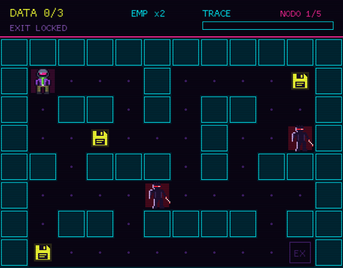

# NETRUNNER

Gioco a turni su griglia in stile 8-bit, ambientato in un futuro cyberpunk.
Sei un netrunner: entra nei nodi di rete, ruba i dati e scappa prima che il
sistema ti tracci.

Scritto in **Rust** con **[macroquad](https://macroquad.rs/)**, nato come
progetto per imparare il linguaggio.



## Come si gioca

Ogni nodo è una griglia. Per violarlo devi:

1. raccogliere tutti i **DATA** (i floppy gialli);
2. raggiungere l'uscita **EX**, che si apre solo quando hai tutti i dati;
3. farlo prima che la barra del **TRACE** si riempia: ogni mossa la fa avanzare.

Gli **ICE** (le sagome con il visore rosso) ti inseguono, e ogni dato rubato fa
scattare l'allarme: compare un nuovo ICE nel punto più lontano da te.

Il gioco è a turni: se non ti muovi, il mondo resta fermo.

### Comandi

| Tasto | Azione |
|---|---|
| Frecce | Muoversi |
| Spazio | **EMP**: congela tutti gli ICE per 6 mosse (cariche limitate) |
| A | Ricomincia il nodo / passa al nodo successivo |
| F11 | Schermo intero / finestra |
| Esc | Esci |

Gli ICE congelati diventano azzurri e si possono attraversare.

### I nodi

| # | Nome | Note |
|---|---|---|
| 1 | Mercato Nero | Tutorial: si vince anche senza EMP |
| 2 | Clinica Fantasma | L'EMP aiuta, ma non è obbligatorio |
| 3 | Banca Orbitale | Il primo nodo in cui l'EMP serve davvero |
| 4 | Torre Kaze-Corp | ICE vicini fin dall'inizio |
| 5 | Datafortezza | Una sola strada possibile: usa bene entrambi gli EMP |

Tutti i nodi sono stati verificati con un risolutore automatico che riproduce
le regole del gioco: sono tutti vincibili.

## Compilare ed eseguire

### Requisiti

- [Rust](https://rustup.rs/) (toolchain stabile)
- Su Linux, le librerie di sistema per grafica e audio. Su Debian/Ubuntu:

  ```bash
  sudo apt install pkg-config libx11-dev libxi-dev libgl1-mesa-dev libasound2-dev
  ```

### Avvio

```bash
git clone <url-del-repository>
cd netrunner
cargo run
```

La prima compilazione richiede qualche minuto. Per una versione ottimizzata:

```bash
cargo run --release
```

> Nota: il gioco carica immagini e suoni dalla cartella `assets/`, che deve
> trovarsi nella cartella da cui viene lanciato l'eseguibile.

## Struttura del progetto

```
netrunner/
├── Cargo.toml
├── assets/          sprite (.png) ed effetti sonori/musica (.wav)
├── docs/            immagini per questo README
└── src/
    └── main.rs      tutto il codice del gioco
```

Dentro `main.rs`:

- `LEVELS`: la definizione dei nodi (mappa, trace, velocità degli ICE, cariche EMP).
  Per aggiungere un nodo basta aggiungere un blocco `LevelDef`.
- `Game`: lo stato della partita, con `update()` (logica) e `draw()` (disegno).
- `Sprites` e `Sounds`: caricamento di grafica e audio all'avvio.

### Formato delle mappe

| Carattere | Significato |
|---|---|
| `#` | muro |
| `.` | pavimento |
| `P` | posizione iniziale del giocatore |
| `D` | dato da raccogliere |
| `E` | uscita |
| `I` | ICE |

Tutte le mappe devono avere la stessa dimensione (12×9).

## Roadmap

- [ ] Colonna sonora definitiva (quella attuale è provvisoria)
- [ ] Tile in pixel art per muri e pavimento
- [ ] Schermata del titolo
- [ ] ICE con pathfinding vero
- [ ] Tipi diversi di ICE
- [ ] Boss fight finale
- [ ] Versione web (WebAssembly) giocabile su itch.io

## Crediti

- Codice, sprite ed effetti sonori: realizzati per questo progetto.
- Font: quello predefinito di macroquad.

## Licenza

Distribuito con licenza **MIT**: vedi il file [LICENSE](LICENSE).
